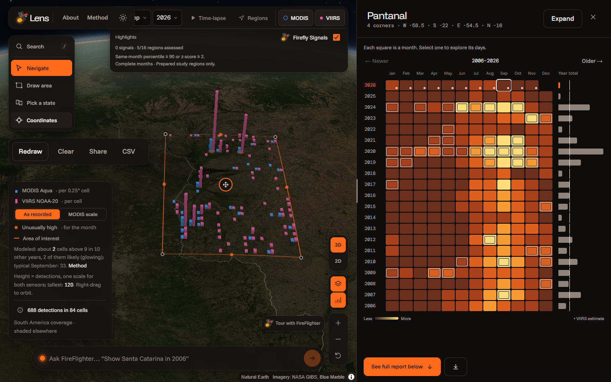
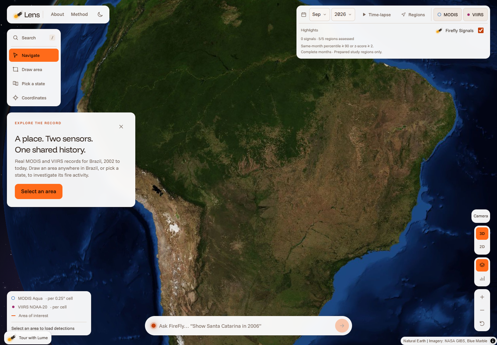
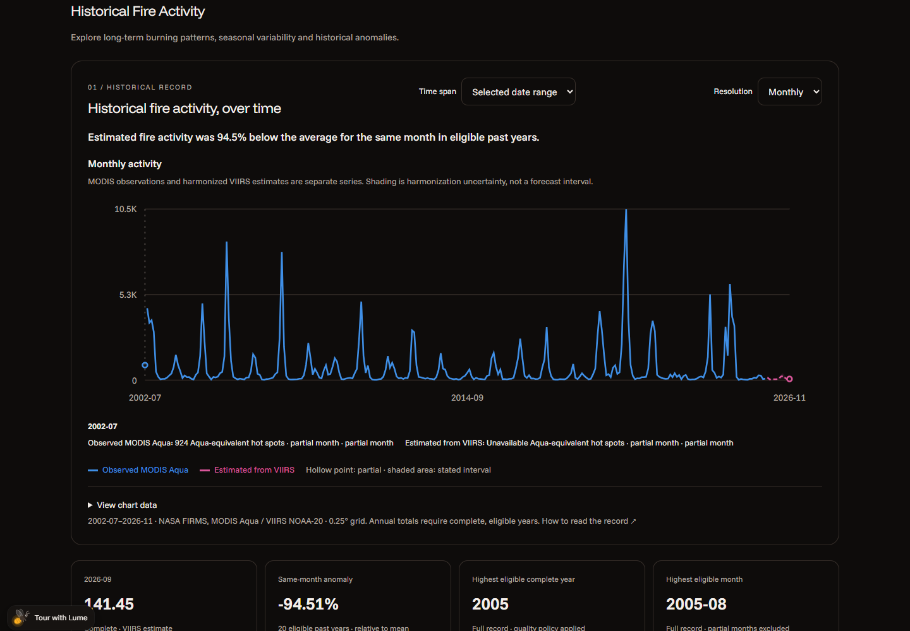
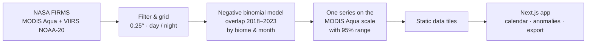

<div align="center">


# FireFly Lens

**One fire calendar from two satellite sensors.**

MODIS and VIIRS active-fire detections, harmonized onto one scale and read as a calendar of fire activity across South America.

[](https://firefly-lens.vercel.app)
[](https://github.com/ThallesCansi/firefly-lens/actions/workflows/ci.yml)
[](https://www.spaceappschallenge.org/)
[](LICENSE)

[**Open the app**](https://firefly-lens.vercel.app) · [Method](https://firefly-lens.vercel.app/method) · [Methodology (PT)](harmonization/docs/METHODOLOGY.md)

<br />



</div>

<br />

## The problem

A hot spot is a pixel that looked hot, not a fire. MODIS sees the ground in 1 km pixels, VIIRS in 375 m, so over Brazil VIIRS reports about **six times** as many detections. Adding the two counts measures pixel size, not burning, and MODIS Aqua, the longest record, is reaching its end.

FireFly Lens writes the whole record on the **MODIS Aqua scale**, so 2002 and 2026 can be compared on the same terms.

<table>
  <tr>
    <td align="center"><h3>506% → &lt;1%</h3>bias of VIIRS against MODIS Aqua,<br/>raw vs. harmonized</td>
    <td align="center"><h3>ρ = 0.99</h3>Spearman rank agreement<br/>on held-out years</td>
    <td align="center"><h3>2002 – 2026</h3>daily record on<br/>a 0.25° grid</td>
    <td align="center"><h3>12 countries</h3>Brazil by biome,<br/>11 more nationally</td>
  </tr>
</table>

## What you can do

|  |  |
|---|---|
| 🗺️ **Explore** | Pan a 3D globe with MODIS and VIIRS detections per grid cell, over NASA Blue Marble imagery. |
| ✏️ **Select** | Draw a polygon, pick a state or country, type coordinates, or choose a study region. |
| 📅 **Read the history** | Every month of every year in one grid, unusual months ringed, each year opening into a daily calendar. |
| 🔥 **Check fire danger** | Current Fire Weather Index for the area, from NASA GFWED / GEOS-5 forecasts. |
| 💬 **Ask FireFlighter** | *"Compare Mato Grosso in 2020 and 2024"*: the assistant moves the map and answers from the record. |
| ⬇️ **Export** | Detections, daily series and monthly tables as CSV; the history grid as SVG. |

<table>
  <tr>
    <td width="50%"></td>
    <td width="50%"></td>
  </tr>
  <tr>
    <td align="center"><sub>Map workspace</sub></td>
    <td align="center"><sub>Historical fire activity</sub></td>
  </tr>
</table>

## How it works



Through 2025 the series is MODIS Aqua as observed; from 2026 it is VIIRS converted. Any area sums its cells weighted by overlap, and each month is compared with the 2003–2025 median for the same month. The full method, validation and limits live on the [`/method`](https://firefly-lens.vercel.app/method) page.

## Run it locally

Requires Node 20.9+ and [pnpm](https://pnpm.io).

```bash
pnpm install
pnpm dev        # http://localhost:3000
pnpm test       # data tiles vs. the Python pipeline
```

The map assistant needs a free [Groq](https://console.groq.com/keys) or Google Gemini key in `.env.local`. Without one, everything else still works.

```bash
GROQ_API_KEY=...
# or GEMINI_API_KEY=...
```

## Repository

```
src/              Next.js app: map workspace, calendars, method page, assistant
public/data/      static data tiles read by the browser
harmonization/    Python pipeline: FIRMS download, model, validation, export
analytics/        optional Python API for polygon history and forecasts
docs/             design notes, validation and screenshots
```

Deep dives: [continental harmonization](docs/continental-harmonization.md) · [fire danger report](docs/weather-first-report.md) · [polygon analytics](docs/dynamic-polygon-analytics.md) · [pipeline](harmonization/README.md)

## Data & credits

[NASA FIRMS](https://www.earthdata.nasa.gov/data/tools/firms) (MODIS C6.1 Aqua, VIIRS 375 m NOAA-20) · NASA GFWED / GEOS-5 · Imagery from [NASA GIBS](https://www.earthdata.nasa.gov/engage/open-data-services-software/earthdata-developer-portal/gibs-api) Blue Marble · IBGE boundaries via [geobr](https://github.com/ipeaGIT/geobr) · [MapLibre GL JS](https://maplibre.org/) · [OpenFreeMap](https://openfreemap.org/) · [Photon](https://photon.komoot.io/)

Built with Next.js, React, TypeScript, Tailwind CSS, MapLibre, Motion and d3.

<br />

<div align="center">
<sub>Made for the NASA Space Apps Challenge 2026 · <i>Harmonization of MODIS and VIIRS Hot Spots</i><br/>Not endorsed by NASA · <a href="LICENSE">MIT License</a></sub>
</div>
